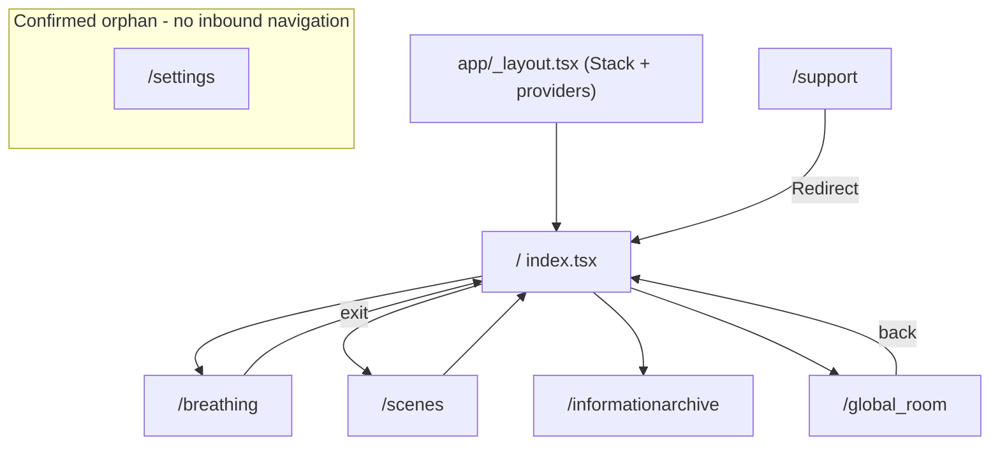
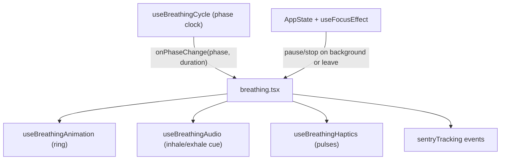
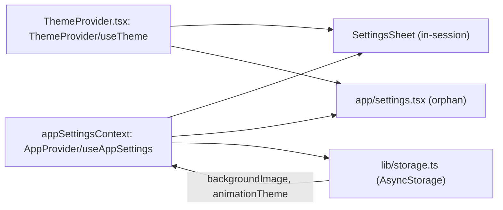
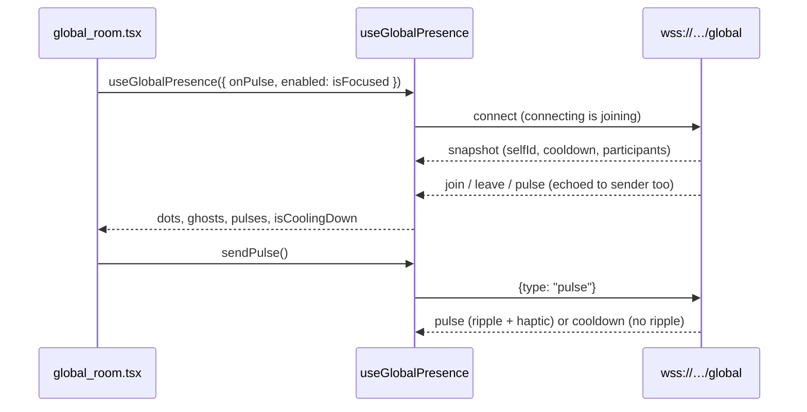

# JustBreatheBro — Architecture Map

> Status: updated 2026-06-23 to reflect cleanup work. Many items flagged as risky or orphaned in
> the original draft have been resolved. `AGENTS.md` is the canonical agent guide and is more
> current than this file on naming and structure details. `docs/FINAL_CLEANUP_REVIEW.md` records
> the full before/after delta of the cleanup.
>
> **Global Room redesign (2026-10):** the three-room "Breathe Together" breathing sessions were
> replaced by a presence + pulse world map. §3 routes, §6 and the Global Room rows below reflect the
> new design; the authoritative description is `AGENTS.md` §4c.

---

## 1. App purpose

JustBreatheBro is a mindfulness and breathing mobile app built with React Native + Expo
(Expo Router). Core capabilities:

- **Guided breathing sessions** — multiple breathing patterns driven by a phase state machine,
  layered with custom animation, hand-produced audio cues, and timed haptics.
- **Ambient soundscapes** — looping background audio that plays app-wide and survives navigation.
- **Information archive** — curated articles, books, and videos (content produced by the external
  BreathBot pipeline).
- **Global Room** — a minimal real-time world map of everyone connected, where anyone can send one
  gentle haptic pulse. Presence + pulses over WebSocket (`/global`); no breathing clock or audio.

Tech stack (see [package.json](../package.json), [app.json](../app.json)): Expo `~54`,
React Native `0.81`, `expo-router ~6`, `react-native-reanimated ~4`, `@gorhom/bottom-sheet`,
`expo-audio`, `expo-haptics`, AsyncStorage, and Sentry for monitoring. New Architecture and the
React Compiler are enabled (`newArchEnabled`, `experiments.reactCompiler` in `app.json`).

---

## 2. Folder structure

```
Breath/
  app/                 Expo Router routes (file-based routing)
    _layout.tsx        Root layout: Sentry init, audio mode, providers, Stack
    index.tsx          Home screen (ACTIVE entry)
    breathing.tsx      Solo breathing session screen (~496 lines)
    settings.tsx       Full-screen settings — confirmed orphan (no inbound navigation found)
    scenes.tsx         Wallpaper / scene picker (ACTIVE)
    informationarchive.tsx   Information archive browser
    global_room.tsx    Global Room: world map of presence + pulse button
    support.tsx        Legacy route -> Redirect to "/"
    _deprecated/       Dormant routes — DO NOT edit, DO NOT lint
      exercises.tsx    Exercise grid (no entry point; preserved for possible restoration)
      breathsetup.tsx  Custom pattern builder (no entry point; preserved)

  components/          Presentational + sheet components (all PascalCase)
    Theme.tsx          Barrel re-export: ThemeProvider, useTheme, useWallpaperForeground + token types
    ThemeProvider.tsx  ThemeProvider + useTheme implementation — visual tokens
    BaseBottomSheet.tsx     Shared bottom-sheet contract
    BottomSheet*.tsx        Sheet building blocks (rows, toggles, section titles, dividers)
    SettingsSheet.tsx, SupportSheet.tsx, ExerciseDetailSheet.tsx, ExerciseSelectionSheet.tsx
    SoundPicker / SoundscapePicker / ThemePicker / AppearancePicker   Unified pickers (variant prop: 'page' | 'bottomSheet')
    BottomSheetSoundHapticsPicker.tsx  Sheet-variant sound/haptics toggles (separate from SoundHapticsPicker)
    BackgroundSoundscapePlayer.tsx   Mounts the app-wide soundscape hook (renders null)
    BreathingPage*.tsx, GlobalRoom*.tsx, WallpaperCarousel.tsx, WallpaperPreview.tsx, ...

  contexts/
    appSettingsContext.tsx  App settings + wallpaper state (AppProvider, useAppSettings) — NOT theme tokens
    breathingContext.tsx    Current selected exercise (BreathingProvider, useBreathing)

  hooks/
    useBreathingCycle.ts      Phase state machine
    useBreathingAnimation.ts  Reanimated ring values
    useBreathingAudio.ts      Inhale/exhale cue playback
    useBreathingHaptics.ts    Phase-quantized haptic pulses
    useBreathingSheets.ts     Sheet open/close coordination for home/session
    useBackgroundSoundscape.ts  App-wide looping ambient audio
    useGlobalPresence.ts      Global Room client: socket, presence, pulses, cooldown
    useGlobalPulseHaptics.ts  One soft tap per incoming pulse
    __tests__/                Jest tests (useBreathingCycle, useBreathingAudio, useBreathingHaptics,
                              useGlobalPresence, useGlobalPulseHaptics, lib/*)

  lib/
    storage.ts                AsyncStorage wrappers + defaultExercises
    informationArchive.ts     Archive CRUD over AsyncStorage + JSON defaults
    informationArchive.json   Seed content
    breathRoomBackend.ts      WebSocket / HTTP endpoint config for live rooms
    breathingHapticsResolve.ts  Pure helper: pulse plan math

  constants/featureColors.ts  Theme preview color tables
  utils/sentryTracking.ts     Breathing analytics events (entered/started/exited)
  assets/                     Sounds, soundscapes, zenscape backgrounds, icons, readme media

  Config: app.json, eas.json, package.json, tsconfig.json, metro.config.js,
          jest.config.js, eslint.config.js, .cursorrules
  Docs:   README.md (marketing), project.md (legacy brainstorm), docs/ARCHITECTURE.md (this file)
```

---

## 3. Every route

Routing is file-based via Expo Router. The root navigator is a `Stack` defined in
[app/_layout.tsx](../app/_layout.tsx) (`animation: "none"`, headers hidden).

| Route | File | Reachable from | Status |
|---|---|---|---|
| `/` | [app/index.tsx](../app/index.tsx) | App launch; `router.push('/')` from several screens | Active (home) |
| `/breathing` | [app/breathing.tsx](../app/breathing.tsx) | `index.tsx` start button (with `autoStart` param) | Active |
| `/scenes` | [app/scenes.tsx](../app/scenes.tsx) | `index.tsx` (circle press) | Active |
| `/informationarchive` | [app/informationarchive.tsx](../app/informationarchive.tsx) | `index.tsx` | Active |
| `/global_room` | [app/global_room.tsx](../app/global_room.tsx) | `index.tsx` (One Breath page → Join) | Active (the old `/global_room_picker` was removed) |
| `/settings` | [app/settings.tsx](../app/settings.tsx) | No `router.push('/settings')` found anywhere — in-session settings use `SettingsSheet` | **Confirmed orphan** — review pending |
| `/support` | [app/support.tsx](../app/support.tsx) | Deep link `/support`; renders `<Redirect href="/" />` | Legacy stub (intentional) |

Route map of the active surfaces:



---

## 4. Breathing flow (solo session)

Entry point: home [app/index.tsx](../app/index.tsx) → `handleStartPress()` calls
`updateExercise(displayExercise)` (from `useBreathing`) then
`router.push({ pathname: "/breathing", params: { autoStart: "true" } })`.

The session screen [app/breathing.tsx](../app/breathing.tsx) (~496 lines) is the orchestrator. It
composes four layered hooks plus context state. The cycle hook is the clock; the screen forwards
phase transitions to animation, audio, and haptics.

- **State machine** — [hooks/useBreathingCycle.ts](../hooks/useBreathingCycle.ts).
  `useBreathingCycle({ exercise, onPhaseChange, onCycleStart })` exposes phases
  `BreathingPhase = 'inhale' | 'hold1' | 'exhale' | 'hold2' | 'idle'`. It tracks `phase`,
  `timeLeft`, `isRunning`, `isPaused` plus refs (`phaseStartTimeRef`, `phaseDurationRef`,
  `remainingTimeRef`) to support pause/resume without drift. A 1-second `setTimeout` drives the
  visible countdown; an async `sleep()` that respects pause drives phase advancement.
- **Animation** — [hooks/useBreathingAnimation.ts](../hooks/useBreathingAnimation.ts). Reanimated
  shared values `radius` (66↔179) and `strokeWidth` (3↔6). API: `animateInhale`, `animateExhale`,
  `seekToPhaseProgress` (snap on resume), `pause`, `resume`, `reset`. Rendered as an
  `Animated` SVG `Circle` in the screen.
- **Audio cues** — [hooks/useBreathingAudio.ts](../hooks/useBreathingAudio.ts).
  `useBreathingAudio({ soundEnabled, isRunning, soundType })`. Loads separate inhale/exhale `.wav`
  files per `SoundType` (`synth | guzheng | sine`; `off` uses sine as an unplayed placeholder to
  keep hook order stable). Two `useAudioPlayer` instances at volume `0.3`.
- **Haptics** — [hooks/useBreathingHaptics.ts](../hooks/useBreathingHaptics.ts).
  `useBreathingHaptics({ hapticsEnabled })` returns `beginPhase` / `cancel`. Pulses are quantized
  across the phase via `resolvePhasePulsePlan` from
  [lib/breathingHapticsResolve.ts](../lib/breathingHapticsResolve.ts). A `generationRef` guards
  against stale scheduled pulses (idempotent cancel). Per-phase config lives in
  `BREATHING_PHASE_HAPTICS` in `breathing.tsx`; `hapticArgsForBreathingPhase()` maps a phase to
  `BeginBreathingPhaseHapticsArgs`.
- **Analytics** — [utils/sentryTracking.ts](../utils/sentryTracking.ts):
  `trackBreathingEntered`, `trackBreathingStarted`, `trackBreathingExited` (with
  `BreathingExitReason = 'user_exit' | 'unmount' | 'background'`).



Lifecycle safety (per `.cursorrules` invariants): the screen wires `AppState` and
`useFocusEffect` so that backgrounding or navigating away stops timers, audio, and haptics and
settles the animation. The cycle, haptics, and audio hooks are each designed to be idempotent on
stop/cancel.

---

## 5. Settings flow

App-wide settings and wallpaper live in [contexts/appSettingsContext.tsx](../contexts/appSettingsContext.tsx)
(`AppProvider`, `useAppSettings`). This is the **app settings** context, not the visual token theme.

`AppSettings` shape: `soundEnabled`, `hapticsEnabled`, `animationsEnabled`, `backgroundType`,
`soundType` (`SoundType`), `soundscape` (`SoundscapeType`), `animationTheme` (`ThemeName`).
Exposed setters include `updateSettings`, `toggleSound`, `toggleHaptics`, `toggleAnimations`,
`setSoundType`, `setSoundscape`, `setAnimationTheme`, plus `backgroundImage` / `setBackgroundImage`.
Background image defaults to `DEFAULT_ZENSCAPE_BACKGROUND_FILENAME` resolved through
`ZENSCAPE_IMAGE_MAP` from [constants/wallpapers.ts](../constants/wallpapers.ts) (single source of
truth — do not redefine inline).

Visual tokens are a separate concern in [components/Theme.tsx](../components/Theme.tsx)
(`ThemeProvider`, `useTheme`): palette tokens, bottom-sheet tokens (`PlatformColor`-based), and the
breathing animation theme (`grounded | calm | uplifting`). Helpers include
`useBreathingAnimationTokens` and `useWallpaperForeground`.

Persistence runs through [lib/storage.ts](../lib/storage.ts) — `backgroundImage` and
`animationTheme` are saved/loaded; the remaining toggles are in-memory state in the provider.

Settings UI exists in two places:

- **In-session sheet** — [components/SettingsSheet.tsx](../components/SettingsSheet.tsx), opened from
  [app/breathing.tsx](../app/breathing.tsx). Uses
  `SoundPicker`, `SoundscapePicker`, and `ThemePicker` with `variant="bottomSheet"`.
- **Full screen (orphan)** — [app/settings.tsx](../app/settings.tsx). Uses `SoundPicker`,
  `SoundscapePicker`, `ThemePicker`, `AppearancePicker`, `SoundHapticsPicker` with default (`page`)
  variant. No inbound navigation found — confirmed orphan, resolution pending.



---

## 6. Global Room flow

Home (One Breath page) → **Join** → [app/global_room.tsx](../app/global_room.tsx). The screen is a thin
view over [hooks/useGlobalPresence.ts](../hooks/useGlobalPresence.ts) (transport via
`lib/reconnectingSocket.ts`, wire types in `lib/globalPresenceProtocol.ts`, pure state in
`lib/globalPresenceState.ts`) and [hooks/useGlobalPulseHaptics.ts](../hooks/useGlobalPulseHaptics.ts).



Location is never read from the device: the server assigns a coarse, jittered country-level point
from the Cloudflare `CF-IPCountry` header. See `AGENTS.md` §4c for the invariants.
---

## 7. Storage flow

Persistence is AsyncStorage, wrapped in two modules.

[lib/storage.ts](../lib/storage.ts) — keys: `breathing_exercises` (`EXERCISES_KEY`),
`current_exercise` (`CURRENT_EXERCISE_KEY`), `background_image` (`BACKGROUND_IMAGE_KEY`),
`animation_theme` (`ANIMATION_THEME_KEY`). Functions: `getExercises` / `saveExercises`,
`getCurrentExercise` / `saveCurrentExercise`, `getBackgroundImage` / `saveBackgroundImage`,
`getAnimationTheme` / `saveAnimationTheme`, plus `initializeStorage`, `resetStorage`,
`forceUpdateToDefaults`. `defaultExercises: Exercise[]` (Deep Breathing, Box Breathing, 4-7-8, ...)
is the seed data; `Exercise` carries `inhale/hold1/exhale/hold2` plus copy fields.

[lib/informationArchive.ts](../lib/informationArchive.ts) — key `information_archive`
(`ARCHIVE_KEY`), seeded from [lib/informationArchive.json](../lib/informationArchive.json) via
`defaultResources`. Full CRUD + query helpers: `getResources`, `saveResources`, `addResource`,
`updateResource`, `deleteResource`, `getResourceById`, `getResourcesByType`, `getResourcesByTags`,
`searchResources`, `initializeArchive`, `resetArchiveToDefaults`, `clearArchive`. `InformationResource`
includes an `AI_description` field intended for agent/LLM consumption.

Consumers: `breathingContext` loads/saves the current exercise; `appSettingsContext` loads/saves
background image + animation theme; `useBreathingSheets` loads the exercise list; the archive screen
reads resources.

---

## 8. Critical hooks

| Hook | File | Responsibility | Notes |
|---|---|---|---|
| `useBreathingCycle` | [hooks/useBreathingCycle.ts](../hooks/useBreathingCycle.ts) | Phase state machine / clock | Has tests; drift + pause/resume logic; the rest of the session is driven from its callbacks |
| `useBreathingAnimation` | [hooks/useBreathingAnimation.ts](../hooks/useBreathingAnimation.ts) | Reanimated ring values | `seekToPhaseProgress` for resume snap |
| `useBreathingAudio` | [hooks/useBreathingAudio.ts](../hooks/useBreathingAudio.ts) | Inhale/exhale cue playback | Two `useAudioPlayer`s; placeholder source when `off` to keep hook order |
| `useBreathingHaptics` | [hooks/useBreathingHaptics.ts](../hooks/useBreathingHaptics.ts) | Phase-quantized pulses | `generationRef` guards stale timers; idempotent `cancel` |
| `useBreathingSheets` | [hooks/useBreathingSheets.ts](../hooks/useBreathingSheets.ts) | Coordinates detail/selection/support sheets on home + session | Owns refs + open/close state, loads exercises |
| `useBackgroundSoundscape` | [hooks/useBackgroundSoundscape.ts](../hooks/useBackgroundSoundscape.ts) | App-wide looping ambient audio | Mounted once via `BackgroundSoundscapePlayer` in `_layout.tsx`; native loop |
| `useGlobalPresence` | [hooks/useGlobalPresence.ts](../hooks/useGlobalPresence.ts) | Global Room client: presence, pulses, cooldown over `/global` | Mock-WebSocket suite; real-network timing and `CF-IPCountry` untested |

Single-instance rule: the ambient soundscape is mounted exactly once in
[app/_layout.tsx](../app/_layout.tsx) via
[components/BackgroundSoundscapePlayer.tsx](../components/BackgroundSoundscapePlayer.tsx) (which renders
`null`). Do not add competing global players.

---

## 9. External services

- **Sentry** — initialized in [app/_layout.tsx](../app/_layout.tsx) (`initSentryOnce`, DSN inline)
  and configured as an Expo plugin in [app.json](../app.json) (org `breath-bro`). PII-stripping in
  `beforeSend`; replays only on errors. Custom breathing events in
  [utils/sentryTracking.ts](../utils/sentryTracking.ts).
- **Live WebSocket backend** — `wss://api.hellobreathbro.app` (`/global` for the Global Room; the
  legacy breathing-room protocol + `GET /api/rooms` stay for installed builds), configured in
  [lib/breathRoomBackend.ts](../lib/breathRoomBackend.ts), overridable via `EXPO_PUBLIC_*` env vars.
  Node service hosted on Render (per README). Separate repo: `breatheAppWebSocketBackEnd`.
- **BreathBot content pipeline** — external RAG workflow that generates/validates the information
  archive content seeded in [lib/informationArchive.json](../lib/informationArchive.json). Separate
  repo: `AIBreathBot`. The app consumes the output JSON only.
- **Expo / EAS** — build + OTA via `expo-updates` (`Updates.channel`), EAS project id in
  `app.json`. Audio session configured in `_layout.tsx` (`setAudioModeAsync`, background audio mode
  on iOS via `UIBackgroundModes: ["audio"]`).
- **App stores** — iOS live (App Store), Google Play not yet live (per README).

---

## 10. Risky areas

1. **Session lifecycle invariants** — timers/audio/haptics/animation in
   [app/breathing.tsx](../app/breathing.tsx) and the breathing hooks. Any change must preserve:
   idempotent start/pause/resume/stop, no duplicate timers across re-renders, full teardown on
   stop/unmount/navigation-away, and no double-triggered cues on re-render (see `.cursorrules`).
2. **Global Room lifecycle** — [hooks/useGlobalPresence.ts](../hooks/useGlobalPresence.ts): one socket,
   one expiry timer, full teardown on unmount/unfocus/background; server owns presence and pulses.
3. **Large files** — `breathing.tsx` (~496). High cognitive load and merge risk.
4. **`app/_tabs/` — deleted.** The tab navigator and its duplicate screens have been removed.
   Navigation is Stack-only via `app/_layout.tsx`.
5. **`hooks/useSwipeNavigation.ts` — deleted.** It was unused and referenced non-existent routes.
6. **Remaining orphan route** — `app/settings.tsx` has no inbound `router.push('/settings')`.
   Resolution is pending (see §3 table and `docs/ROUTE_AUDIT.md`).
7. **Picker duplication — largely resolved.** `SoundPicker`, `SoundscapePicker`, `ThemePicker`,
   `AppearancePicker` each accept `variant: 'page' | 'bottomSheet'`. The remaining duplicate is
   `SoundHapticsPicker` vs `BottomSheetSoundHapticsPicker` — not yet unified.
8. **`WALLPAPER_IMAGES` duplication — resolved.** Single source in
   [constants/wallpapers.ts](../constants/wallpapers.ts); `wallpaper.tsx` is deleted.
9. **Naming — largely resolved.** `contexts/appSettingsContext.tsx` exports `useAppSettings` /
   `AppProvider`. All component files are PascalCase. `Theme.tsx` is the barrel re-exporter;
   `ThemeProvider.tsx` holds the implementation.
10. **Test coverage — expanded.** 76 tests across 6 suites: cycle, audio, haptics, storage,
    live-room URL/config, and live-room join/leave/reconnect/cleanup. Still untested:
    `useBackgroundSoundscape`, `useBreathingSheets`.
11. **Tooling — fixed.** `reset-project` script removed; `dummy.ipynb` deleted.
12. **Source-of-truth** — `AGENTS.md` is the canonical agent guide. This file is a supporting
    architecture reference; `docs/FINAL_CLEANUP_REVIEW.md` records the cleanup delta.

---

## 11. Suggested cleanup order

Each step should reduce total complexity and be verifiable with `npm run lint`, `npm test`,
`npx tsc --noEmit`, and a manual core-flow check (start session → pause/resume → exit;
change settings; join/leave room).

**Completed (as of 2026-06-23):**
- Removed `_tabs/`, `wallpaper.tsx`, `exercises.tsx`, `breathsetup.tsx`, `breath_bot_landing.tsx`,
  `useSwipeNavigation.ts`, `dummy.ipynb`, and the broken `reset-project` script.
- Renamed `themeContext.tsx` → `appSettingsContext.tsx`; brought all component files to PascalCase.
- Consolidated `WALLPAPER_IMAGES` into `constants/wallpapers.ts`.
- Unified pickers behind `variant` prop (Sound, Soundscape, Theme, Appearance).
- Expanded tests: 76 tests / 6 suites (audio, haptics, storage, live-room behavior).
- Fixed 3 `TS2367` type errors in `useBreathingCycle.ts`; `tsc --noEmit` now exits 0.
- Extracted presentational pieces into `BreathingPage*` and `GlobalRoom*` components.

**Remaining:**
1. **Resolve `app/settings.tsx` orphan** — wire up an entry point, merge unique sections into
   `SettingsSheet`, or delete after comparison. See `docs/ROUTE_AUDIT.md`.
2. **Unify `SoundHapticsPicker` / `BottomSheetSoundHapticsPicker`** — last remaining picker duplicate.
3. **Rename `AppearanceButton`** — it is a generic toggle button, not appearance-specific.
4. **Expand tests** — `useBackgroundSoundscape`, `useBreathingSheets` still untested.

---

*This document describes current behavior only. Verify any "likely orphan" / "appears excluded"
item against a running build before removing code.*
